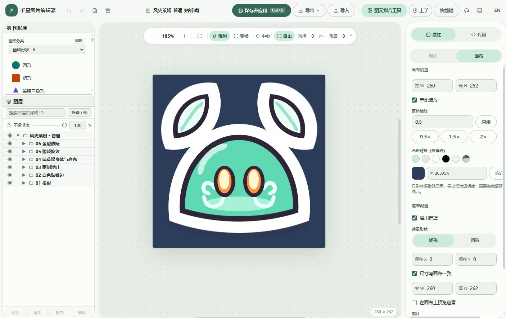
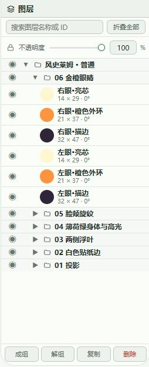
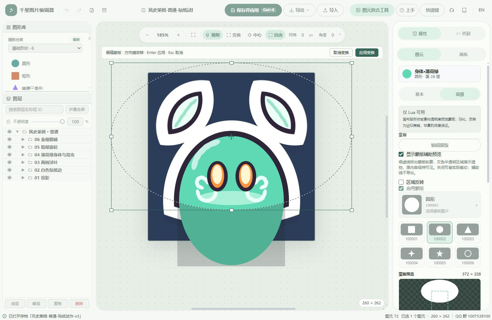

# 千星图片编辑器

**中文** · [English](README.md) · [在线使用](https://qx.070077.xyz/)

在浏览器里用图形、游戏素材和文字拼出千星奇域 UI，再导出 GIA 或客户端 Lua 绘制脚本。支持手工编辑，也支持通过 WebMCP 让 AI 操作同一张画布。

## 项目来源与本分支

本仓库是 [Miliastra-image-editor-webui](https://github.com/1475505/Miliastra-image-editor-webui) 的下游 fork。上游提供浏览器里的千星奇域 UI 拼图与 GIA／Lua 导出；本分支保留其导出格式和既有用法，在此之上继续开发。

目标是把编辑器逐步演进为更接近 Photoshop 的**场景编辑器**：图层和组可以长期维护，变换、蒙版和结构都能反复修改，而不是拼好一次就导出的工具。`main` 只镜像上游，功能开发在 `develop`；分支模型、上游同步步骤与兼容约束见 [Fork 维护与上游同步](docs/fork.md)。

### 与上游的主要区别

以下是 `develop` 相对上游镜像 `main` 的实际改动，按提交历史归纳：

| 方向 | 本分支新增或改动 |
|---|---|
| 图层与组 | 常驻图层树、嵌套组与拖拽、组显隐／独显／不透明度、搜索；图元的显隐、图层名和组归属写入场景 |
| 锁定 | 图元与组可锁定，阻止画布选中、拖动和属性修改；WebMCP 仍可显式修改 |
| 结构 | 智能对象：组合收为一个图层，内部图元不栅格化，可再次进入编辑 |
| 变换 | 中心／自由放缩、选框单轴手柄、多选整体缩放与旋转、显式变换模式与属性预览、以光标为中心的滚轮缩放 |
| 蒙版 | 独立蒙版编辑（移动、缩放、框外旋转、区域反转）、反向范围按旋转矩形收边、辅助预览拖动优化 |
| 工作流 | 历史存档、新建画布、导入弹窗（覆盖／追加、格式自动识别、追加自动归组）、空白画布右键快捷图形库 |
| AI 协作 | 在上游 WebMCP 基础上增加图元能力表、锁定语义与批量建立图层组 |
| 工程 | Vitest 组件测试；构建产物与本地脚本不入库 |

绘制导出仍沿用上游约定：导出时按可见性过滤并烘焙组不透明度，JSON 保留完整结构。逐条差异与合并注意事项以 [Fork 维护与上游同步](docs/fork.md) 为准。

## 功能一览

编辑器界面：左侧图形库与图层，中间画布，右侧图元与蒙版属性。



图层与组：常驻图层树支持嵌套组、锁定、显隐与独显；选中组即可整体调整。



蒙版与羽化：在图元「高级」中启用蒙版，画布用虚线轮廓和半透明遮挡显示被遮区域，右侧同步预览范围。



## 三步开始

1. 打开[编辑器](https://qx.070077.xyz/)，从左侧图形库拖入或双击添加素材；已有 CSS、SVG、JSON 或支持的 Lua 可从「导入」继续编辑。
2. 在画布移动、缩放、旋转图元；右侧调整文字、颜色、图片类型和蒙版，「高级」可单独编辑蒙版。Shift 点选或在空白处拖框可多选。
3. 「导出 → JSON」保存可继续编辑的作品；使用 GIA 或 Lua 将作品带入游戏编辑器。

**「保存并应用」会更新编辑器和已保存图元，不会保存文件。刷新或关闭页面前，请先导出作品。**

## 主要功能

- 矩形、圆形、三角形、星形、圆环拼图。
- 游戏图片素材搜索、分类、基础／拉伸、染色与图层排序。
- 可编辑文本框：富文本、字号自适应、描边和对齐。
- 多选、框选、整体移动、复制粘贴、快捷键与撤销重做。
- 图层与组：编组、嵌套、锁定、显隐与独显。
- 可编辑智能对象：组合成为单个图层，内部图元不栅格化，仍可进入编辑。
- Lua 蒙版与羽化，可在「高级」进入独立蒙版编辑移动、缩放和框外旋转蒙版；虚线轮廓和半透明覆盖帮助查看被遮住的内容。
- 按准确 ID 查询元件缩略图，保存 JSON 或导出 Lua 绘制。


[打开渐变字示例](demo/gradient-text.md)。需要将位图转成图元，可使用配套的[图元拟合工具](https://qx-img.070077.xyz/)。

## 智能对象

右键普通组或同一父级下连续选中的普通图层，选择「转换为智能对象」；不连续或跨父级图层请先显式编组。外层可作为单层移动、Z 旋转和正向等比缩放；复制得到独立内容，不联动原件。暂不支持嵌套智能对象。

「编辑对象内容」进入独立局部草稿。画框只读，编辑中保持稳定，不裁剪溢出内容。有改动时，「保存并继续编辑」（`Ctrl/⌘+S`）或「完成编辑」按全部图层（含隐藏／锁定）的几何边界适配画框；通过局部坐标平移和对象位置补偿，保持编辑后内容在主场景中的视觉位置，对象旋转和缩放不变，但中心与外框可变。空内容保留上次画框，没有手动画框尺寸入口。

「保存并继续编辑」将变化应用为一次主撤销并留在编辑态，内部撤销／重做保留；无变化不适配、不新增历史。「完成编辑」只应用最近保存后的新改动并退出；「放弃本次修改」不会撤回已保存的内容。「解除为普通组」在可精确表示变换时保留当前外观与父级归属。

JSON 保留完整可编辑对象；绘制格式先展平，无法精确表示的组合会明确诊断，不静默改图。Lua 另带与绘图摘要绑定的编辑快照，外部修改绘图数据后回导会警告，不能恢复陈旧对象结构。详见[智能对象使用说明](docs/README.md#智能对象)。智能对象导出尚未真机验证。

## 如何选择导出格式

| 格式 | 用途 | 注意事项 |
|---|---|---|
| JSON | 保存作品、继续编辑 | 保留场景设置和已保存图元 |
| Lua | 在客户端 UI 中绘制原生图片与文字 | 填写真实控件模板索引，并映射、挂载脚本 |
| GIA | 导入游戏编辑器的界面素材组 | 含元件或已启用图元蒙版／羽化的作品改用 Lua |
| 容器节点 GIA | 导入为客户端控件模板，图元即其图片子控件 | 无需脚本；文本框、元件与圆形画布遮罩暂不导出 |
| CSS / SVG | 分享或使用支持的图元子集 | SVG 会省略圆环，复杂 SVG 不保证无损回导 |
| PNG | 通过 API 或 AI 工具获取渲染图 | 含元件或已启用图元蒙版／羽化时不可用 |

画布背景仅用于查看。导出需要实色底时，添加铺满画布的矩形。网页蒙版效果为近似预览，最终效果请在游戏中检查。

## 常用键盘操作

Windows/Linux 使用 `Ctrl`，macOS 使用 `⌘`。

- Shift 点选增减选择；图层列表 Shift 连选。
- 空白拖动框选；空格拖动或中键拖动平移视图。
- `Ctrl/⌘+A、C、X、V、D`：全选、复制、剪切、粘贴、创建副本。
- 方向键微调 1px，Shift+方向键为 10px；Delete 删除所选。
- `Ctrl/⌘+Z` 撤销，`Ctrl/⌘+Shift+Z` 或 `Ctrl/⌘+Y` 重做。
- 顶部「快捷键」或 `?` 查看完整键位。输入框和弹窗保留自身按键。

## WebMCP：让 AI 帮你拼图

在能发现页面 WebMCP 工具的浏览器／AI 客户端中打开编辑器，让 AI 先列出当前页面工具，再描述目标，例如：

> 保留现有作品，做一张 600×400 的标题卡：深色底、三个图片元素和居中标题。完成后导出 JSON。

工具支持素材搜索、看图、批量编辑、按部件整理命名嵌套图层组、导入导出和撤销。它们操作当前打开的页面；本项目不提供独立 MCP 服务。没有发现工具时，检查浏览器接入是否提供 `document.modelContext.registerTool`；普通浏览器仍可手工使用。

整理图层组时，AI 先读取当前图元和组 ID，再按部件一次建组，例如「火史莱姆 → 身体／角／眼睛」。一批只占一步撤销，组名随作品 JSON 保存；已有父组的隐藏与透明度继续生效，图元不重排。

[接入步骤与调用示例](docs/webmcp.md) · [可复用 AI 技能](skills/)

## 本地运行

准备 **Python 3.13** 和 **Node.js 20+**（含 npm），下载源码后在仓库根目录执行：

```powershell
# Windows PowerShell
.\start.bat
```

```bash
# Linux / macOS
bash start.sh
```

启动脚本安装依赖、构建前端并启动服务，访问 **http://localhost:8439**。也可直接使用 Docker，镜像构建会自动编译前端：

```bash
docker build -t miliastra-image-editor .
docker run --rm -p 8439:8439 miliastra-image-editor
```

## 更多说明

- [使用指南与文档导航](docs/README.md)
- [多选、鼠标与快捷键](docs/editor-interaction.md)
- [Lua 导出与蒙版](docs/lua-mask.md)
- [开发和部署](docs/deploy.md)
- [维护说明：源码分工与兼容契约](docs/technical-design.md)
- [反馈问题](https://github.com/1475505/Miliastra-image-editor-webui/issues)

使用请遵守奇匠守则，尊重他人版权。[许可证](LICENSE)。
